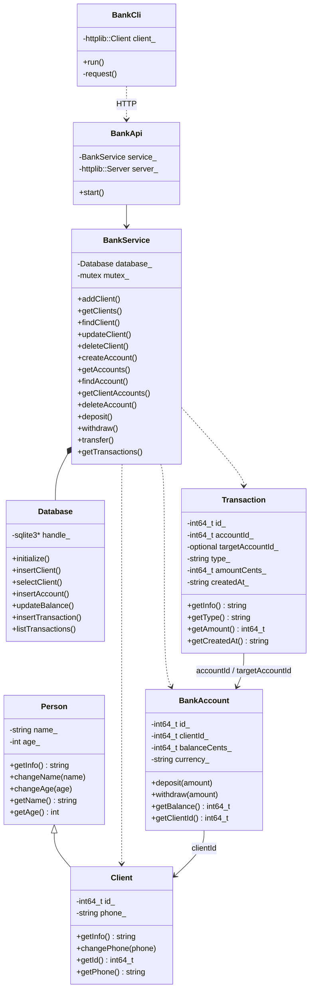

# Банковское приложение — курсовая работа по ООП на C++

**Студент:** Александр Шеховцов  
**Группа:** ПКС 5-24  
**Платформа:** Arch Linux x86_64 + Fish  
**Язык:** C++20  
**Назначение:** учебное приложение. Настоящие деньги, реальные банки и пользовательская авторизация не используются.

## 1. Описание системы

Программа позволяет регистрировать клиентов банка (без создания учётных записей), открывать счета в кыргызских сомах, пополнять счета, снимать средства, переводить деньги между счетами и просматривать историю. Сервер хранит информацию в локальном SQLite-файле, консольная программа работает с сервером **только по HTTP**.

Система состоит из двух независимых программ:

- `bank_server` — сервер на C++, REST API, правила банка, работа с SQLite.
- `bank_cli` — консольное меню на C++, HTTP-запросы и печать результатов.

У приложения нет веб-страниц, графического интерфейса, авторизации и интеграции с действующими платёжными системами.

## 2. Цель курсовой работы

Разработать понятную банковскую информационную систему на C++20, которая на реальных объектах демонстрирует принципы объектно-ориентированного программирования (ООП) и сохраняет данные в базе SQLite.

## 3. Задачи разработки

1. Определить предметные классы и их ответственность.
2. Применить инкапсуляцию, наследование, полиморфизм, абстракцию и композицию.
3. Реализовать ограничения на возраст, данные клиентов, балансы и переводы.
4. Создать постоянное SQLite-хранилище и историю всех операций.
5. Реализовать JSON REST API на C++.
6. Реализовать консольный HTTP-клиент, устойчивый к ошибкам ввода и сети.
7. Подготовить воспроизводимую сборку для Arch Linux через CMake и vcpkg.

## 4. Используемые технологии

| Технология | Назначение |
| --- | --- |
| C++20 | Язык реализации приложения и ООП |
| CMake 3.21+ | Сборка сервера и CLI |
| vcpkg | Управление зависимостями (`vcpkg.json`) |
| cpp-httplib | HTTP-сервер и HTTP-клиент |
| SQLite3 C API | Данные на диске, SQL и атомарные транзакции |
| nlohmann/json | Чтение и формирование JSON |
| Стандартная библиотека | Строки, контейнеры, RAII, файлы, время, синхронизация |

Набор портов vcpkg зафиксирован через `builtin-baseline` в `vcpkg.json`. Используются только три указанные внешние библиотеки.

## 5. Архитектура и разделение ответственности

- **Models** — классы `Person`, `Client`, `BankAccount`, `Transaction` и проверки их состояния.
- **BankService** — реализация банковских сценариев и взаимодействие объектов.
- **Database** — единственное место с SQL, подготовленными запросами и транзакциями.
- **BankApi** — HTTP-маршруты, JSON-валидация, статусы и формат ответов.
- **BankCli** — консольные меню, запросы через `httplib::Client` и сообщения.
- **main.cpp** — только настройка и запуск соответствующей программы.

Путь данных: `bank_cli` → HTTP → `bank_server` → `BankApi` → `BankService` → `Database` → `data/bank.db`.

## 6. Структура файлов

```text
banking-app-arch-fish/
├── include/
│   ├── models/
│   │   ├── Person.h
│   │   ├── Client.h
│   │   ├── BankAccount.h
│   │   └── Transaction.h
│   ├── services/
│   │   ├── BankError.h
│   │   └── BankService.h
│   ├── storage/Database.h
│   └── api/BankApi.h
├── src/
│   ├── models/Person.cpp, Client.cpp, BankAccount.cpp, Transaction.cpp
│   ├── services/BankService.cpp
│   ├── storage/Database.cpp
│   ├── api/BankApi.cpp
│   ├── server/main.cpp
│   └── cli/main.cpp, BankCli.h, BankCli.cpp
├── data/.gitkeep
├── CMakeLists.txt
├── CMakePresets.json
├── vcpkg.json
├── run_server.fish
├── run_cli.fish
├── GUIDE_ARCH_FISH.md
├── .gitignore
└── README.md
```

Каталог `data/` создаётся автоматически. База `data/bank.db` появляется при первом запуске сервера. Сама база в архив не включена, поскольку должна создаваться на компьютере пользователя.

## 7. Основные классы: поля и методы

### `Person` (`include/models/Person.h`)

**Приватные поля:** `name_` (ФИО), `age_` (возраст).  
**Конструктор:** `Person(name, age)` — проверяет данные.  
**Методы:** `virtual ~Person()`, `virtual getInfo()`, `changeName()`, `changeAge()`, `getName()`, `getAge()`. Проверка возраста: 18–100 лет.

### `Client : public Person` (`include/models/Client.h`)

**Приватные поля:** `id_` и `phone_`, поля базового класса наследуются.  
**Конструктор:** `Client(id, name, age, phone)` вызывает `Person(name, age)`.  
**Методы:** `getInfo() override`, `changePhone()`, `getId()`, `getPhone()`. Пустой телефон запрещён. ID выдаёт SQLite при создании записи.

### `BankAccount` (`include/models/BankAccount.h`)

**Приватные поля:** `id_`, `clientId_`, `balanceCents_`, `currency_`.  
**Конструктор:** `BankAccount(id, clientId, balanceCents, currency)`.  
**Методы:** `getInfo()`, `deposit()`, `withdraw()`, `getBalance()`, `getId()`, `getClientId()`, `getCurrency()`.  
**Правила:** валюта только `KGS`, сумма положительна; списание не превышает баланс; переполнение `int64_t` запрещено; публичного метода установки баланса нет.

### `Transaction` (`include/models/Transaction.h`)

**Приватные поля:** `id_`, `accountId_`, `targetAccountId_` (`optional`), `type_`, `amountCents_`, `createdAt_`.  
**Конструктор:** `Transaction(id, accountId, targetAccountId, type, amountCents, createdAt)`.  
**Методы:** `getInfo()`, `getType()`, `getAmount()`, `getCreatedAt()`, `getId()`, `getAccountId()`, `getTargetAccountId()`.  
**Типы:** `deposit`, `withdraw`, `transfer`. Для перевода обязателен другой счёт-получатель.

### `BankService` (`include/services/BankService.h`)

**Поля:** `database_` (`Database`) и `mutex_` (`std::mutex`).  
**Клиенты:** `addClient`, `getClients(search)`, `findClient`, `updateClient`, `deleteClient`.  
**Счета:** `createAccount`, `getAccounts`, `findAccount`, `getClientAccounts`, `deleteAccount`.  
**Финансы:** `deposit`, `withdraw`, `transfer`, `getTransactions`.  
**Внутренние методы:** `requireClient`, `requireAccount`. Удаление клиентов со счетами и счетов с балансом или историей запрещено. Синхронизация обеспечивает безопасный доступ к одному соединению SQLite из HTTP-потоков.

### `Database` (`include/storage/Database.h`)

**Поле:** `handle_` — указатель на соединение SQLite, закрываемое в деструкторе.  
**Методы:** `initialize`, `insertClient`, `listClients`, `selectClient`, `updateClient`, `deleteClient`, `clientHasAccounts`, `insertAccount`, `listAccounts`, `selectAccount`, `clientAccounts`, `updateBalance`, `accountHasTransactions`, `deleteAccount`, `insertTransaction`, `listTransactions`.  
**Вложенный класс:** `TransactionScope` — начинает `BEGIN IMMEDIATE`, вызывает `COMMIT` по явной команде и делает `ROLLBACK` в деструкторе, если операция не завершена.

### `BankApi` (`include/api/BankApi.h`)

**Поля:** `service_` (ссылка на `BankService`), `server_` (`httplib::Server`).  
**Методы:** `BankApi(service)`, `start(host, port)`, `registerRoutes()`. В HTTP-обработчиках нет SQL или банковских расчётов.

### `BankCli` (`src/cli/BankCli.h`)

**Поле:** `client_` (`unique_ptr<httplib::Client>`).  
**Методы:** `run`, `request`, `prompt`, `number`, `amount`, `confirm`, `showClient`, `showAccount`, `showHistory`, `encode`, а также функции для меню клиентов, счетов, финансовых операций и истории. SQLite-код в CLI отсутствует.

### `BankError` (`include/services/BankError.h`)

Учебный класс исключения с HTTP-статусом, кодом и русским сообщением об ошибке. Наследуется от `std::runtime_error`.

## 8. Принципы ООП

### Инкапсуляция

Поля всех моделей приватны. Изменение имени, возраста, телефона и баланса проходит через методы с проверками. `BankAccount` не позволяет напрямую задать баланс через сетевой интерфейс; начальный баланс нового счёта всегда нулевой.

### Наследование

`Client` публично наследует `Person`, получает базовые свойства `name_` и `age_`, а его конструктор вызывает `Person(name, age)`.

### Полиморфизм

`Person::getInfo()` объявлен виртуальным, `Client::getInfo()` переопределён. В функции `clientJson()` файла `BankApi.cpp` используется `const Person& person = c; person.getInfo()`. По ссылке на базовый класс выполняется метод `Client`.

### Абстракция

Модель не знает об HTTP и SQLite; `BankService` не знает о JSON, консольном меню и статусах HTTP; `Database` не знает о меню. Каждая часть скрывает детали реализации.

### Композиция

`BankService` владеет `Database` и координирует объекты `Client`, `BankAccount`, `Transaction`. При переводе он загружает два счёта, вызывает у них соответствующие методы, создаёт `Transaction` и поручает `Database` сохранить всё в одной транзакции.

### RAII, конструкторы и деструкторы

Конструкторы проверяют инварианты. Деструктор `Database` закрывает SQLite-соединение. Внутренний объект `Statement` автоматически вызывает `sqlite3_finalize`. `TransactionScope` гарантирует `ROLLBACK` при исключении. `std::lock_guard` автоматически освобождает мьютекс.

## 9. Взаимодействие объектов

1. **Добавление клиента:** `BankService::addClient` создаёт `Client`, `Database` добавляет строку в `clients`, затем по полученному ID загружает объект клиента.
2. **Открытие счёта:** система проверяет существование `Client`, затем создаёт счёт с нулевым балансом и привязывает его к `client_id`.
3. **Пополнение/снятие:** `BankService` загружает `BankAccount`, вызывает `deposit` либо `withdraw`, сохраняет новый баланс и запись операции в одной SQL-транзакции.
4. **Перевод:** загружаются два `BankAccount`; выполняются `withdraw` и `deposit`; создаётся `Transaction`; изменения и запись журнала фиксируются атомарно.
5. **История:** `Database::listTransactions` читает строки SQLite и создаёт реальные объекты `Transaction`, которые API сериализует в JSON.

## 10. UML-диаграмма классов

Диаграмма описывает фактические связи и основные методы реализации.



## 11. База данных SQLite

Файл: **`data/bank.db`** (относительно рабочей папки сервера; `run_server.fish` устанавливает её в корень проекта). Таблицы создаются автоматически при первом запуске.

### Таблица `clients`

`id INTEGER PRIMARY KEY AUTOINCREMENT`, `name TEXT NOT NULL`, `age INTEGER NOT NULL`, `phone TEXT NOT NULL`. Возраст и непустые поля дополнительно ограничены `CHECK`.

### Таблица `accounts`

`id INTEGER PRIMARY KEY AUTOINCREMENT`, `client_id INTEGER NOT NULL`, `balance_cents INTEGER NOT NULL DEFAULT 0`, `currency TEXT NOT NULL DEFAULT 'KGS'`. Внешний ключ `client_id` ссылается на `clients.id`.

### Таблица `transactions`

`id INTEGER PRIMARY KEY AUTOINCREMENT`, `account_id INTEGER NOT NULL`, `target_account_id INTEGER NULL`, `type TEXT NOT NULL`, `amount_cents INTEGER NOT NULL`, `created_at TEXT NOT NULL`. Оба идентификатора счёта имеют внешние ключи на `accounts.id`. Дата хранится как UTC ISO-строка, например `2026-11-18T07:00:00Z`.

Включено `PRAGMA foreign_keys=ON`. Все значения в SQL передаются через `sqlite3_bind_*`; подготовленные запросы вызываются через `sqlite3_prepare_v2`. Изменения баланса и запись истории находятся внутри `BEGIN IMMEDIATE` / `COMMIT`, а при исключении выполняется `ROLLBACK`. Суммы — только `int64_t` в тыйынах. Например, `150.50 KGS` = `15050` тыйын.

Поиск по ФИО выполняет `BankService`: он загружает клиентов и сравнивает строки без учёта регистра для латиницы, русской кириллицы (`А–Я`, `Ё`) и кыргызских букв (`Ң`, `Ө`, `Ү`). Это сделано потому, что встроенная SQLite-сортировка `NOCASE` не поддерживает кириллицу. Для большого банка понадобился бы более производительный поиск, но для курсового проекта решение наглядно.

## 12. REST API

**Адрес:** `http://127.0.0.1:8000`.  
**Формат:** JSON UTF-8.  
**Суммы:** строки (не JSON-числа), например `"150.50"`.

| Метод | Путь | Назначение |
| --- | --- | --- |
| GET | `/health` | Проверка сервера |
| GET | `/clients` | Все клиенты |
| GET | `/clients?search=ИВАН` | Поиск ФИО без учёта регистра и с частичным совпадением |
| POST | `/clients` | Создание клиента |
| GET | `/clients/{id}` | Клиент по ID |
| PATCH | `/clients/{id}` | Изменение имени, возраста или телефона |
| DELETE | `/clients/{id}` | Удаление клиента |
| GET | `/accounts` | Все счета |
| POST | `/accounts` | Открытие счёта |
| GET | `/accounts/{id}` | Данные счёта и баланс |
| DELETE | `/accounts/{id}` | Закрытие счёта |
| GET | `/clients/{id}/accounts` | Счета клиента |
| POST | `/accounts/{id}/deposit` | Пополнение |
| POST | `/accounts/{id}/withdraw` | Снятие |
| POST | `/transfers` | Перевод |
| GET | `/accounts/{id}/transactions` | История операций (включая входящие переводы) |

### Примеры тел запросов

**POST `/clients`:**

```json
{"name":"Иван Иванов","age":25,"phone":"+996 555 123456"}
```

**PATCH `/clients/1`:** достаточно передать изменяемые поля:

```json
{"phone":"+996 700 123456"}
```

**POST `/accounts`:**

```json
{"client_id":1}
```

**POST `/accounts/1/deposit` и `/accounts/1/withdraw`:**

```json
{"amount":"150.50"}
```

**POST `/transfers`:**

```json
{"from_account_id":1,"to_account_id":2,"amount":"20.00"}
```

Ответ создания клиента содержит поля `id`, `name`, `age`, `phone`, `info`. Для счёта: `id`, `client_id`, `balance` (строка с двумя знаками), `currency`. Для операции: `id`, `account_id`, `target_account_id` (или `null`), `type`, `amount` (строка), `created_at`.

### HTTP-статусы и ошибки

- `200` — выполнено, JSON с данными.
- `201` — создан клиент или счёт.
- `204` — удалён клиент или счёт, тело отсутствует.
- `400` — неправильный JSON или неизвестное поле.
- `404` — клиент, счёт или маршрут не найдены.
- `409` — недостаток средств, переполнение, запрет закрытия/удаления.
- `422` — неверный тип, некорректное значение или обязательное поле отсутствует.
- `500` — внутренняя ошибка сервера.

Пример ответа при недостатке средств:

```json
{
  "error": {
    "code": "insufficient_funds",
    "message": "Недостаточно средств на счёте"
  }
}
```

## 13. Установка Arch Linux и Fish: подготовка окружения

Инструкции ниже рассчитаны на **Arch Linux x86_64**, терминал **Fish**, компилятор **GCC**, генератор **Ninja**, CMake 3.21+ и vcpkg в домашнем каталоге. Сборка выполняется **нативно для Linux**, без Wine, MSVC и Windows SDK.

Откройте терминал в Arch Linux. Установите инструменты командой (пароль `sudo` — пароль вашего пользователя):

```fish
sudo pacman -Syu --needed base-devel gcc cmake ninja git curl zip unzip tar fish
```

Откройте Fish, если текущая оболочка ещё не Fish:

```fish
fish
```

Проверьте версии и архитектуру:

```fish
fish --version
uname -m
g++ --version
cmake --version
ninja --version
git --version
```

`uname -m` должен вывести `x86_64`. Вся документация предполагает именно 64-битный Intel/AMD Linux. Если терминал уже работает в Fish, повторно запускать `fish` не требуется.

## 14. Установка vcpkg в Fish

Загрузите vcpkg из официального репозитория Microsoft:

```fish
git clone https://github.com/microsoft/vcpkg.git "$HOME/vcpkg"
cd "$HOME/vcpkg"
./bootstrap-vcpkg.sh
```

В Fish задайте путь к установленному менеджеру зависимостей на постоянной основе:

```fish
set -Ux VCPKG_ROOT "$HOME/vcpkg"
```

Проверьте настройку:

```fish
echo $VCPKG_ROOT
"$VCPKG_ROOT/vcpkg" version
```

**Зачем нужен vcpkg:** он читает `vcpkg.json` и обеспечивает согласованную установку только `cpp-httplib`, `sqlite3` и `nlohmann-json`. Ревизия набора портов закреплена через `builtin-baseline`. Не нужно вручную копировать заголовки сторонних библиотек в проект.

Если vcpkg уже установлен в другом месте, вместо повторного клонирования установите корректное значение:

```fish
set -Ux VCPKG_ROOT "/путь/до/вашего/vcpkg"
```

`VCPKG_ROOT` должен указывать именно на каталог, где существуют `vcpkg` и `scripts/buildsystems/vcpkg.cmake`.

## 15. Распаковка проекта и установка зависимостей

Распакуйте архив `banking-app-arch-fish.zip` через файловый менеджер или в Fish:

```fish
cd ~/Downloads
unzip banking-app-arch-fish.zip
cd banking-app-arch-fish
```

Если скачали файл в другую папку, измените путь. Далее все команды выполняются **из корня проекта** (каталог с `CMakeLists.txt` и `vcpkg.json`). Для проверки:

```fish
pwd
ls CMakeLists.txt vcpkg.json CMakePresets.json
```

Запустите установку зависимостей:

```fish
"$VCPKG_ROOT/vcpkg" install --triplet x64-linux
```

При первой установке потребуются Интернет и время на сборку библиотек. Используется режим **manifest**, а содержимое зависимостей устанавливается в `vcpkg_installed/`. Этот каталог не нужно переносить между компьютерами.

## 16. Сборка Linux-приложения через CMake

Команды Fish из корня проекта:

```fish
cmake --preset arch-release
cmake --build --preset arch-release
```

Пресет использует `Ninja`, `Release`, `x64-linux` и `"$VCPKG_ROOT/scripts/buildsystems/vcpkg.cmake"`. Должны появиться **два нативных Linux-файла** (не `.exe`):

```text
build/bank_server
build/bank_cli
```

Альтернативный способ сборки без пресета:

```fish
cmake -S . -B build -G Ninja -DCMAKE_BUILD_TYPE=Release -DCMAKE_TOOLCHAIN_FILE="$VCPKG_ROOT/scripts/buildsystems/vcpkg.cmake" -DVCPKG_TARGET_TRIPLET=x64-linux
cmake --build build
```

Не следует менять `VCPKG_ROOT`, triplet или генератор при уже существующем `build/`. Если настройка поменялась, удалите старый каталог конфигурации:

```fish
rm -rf build
cmake --preset arch-release
cmake --build --preset arch-release
```

Для отдельной отладочной сборки доступны `cmake --preset arch-debug` и `cmake --build --preset arch-debug`; результат находится в `build-debug/`. Скрипты запуска по умолчанию используют **Release** из `build/`.

## 17. Запуск сервера и клиента в двух терминалах Fish

**Терминал № 1 — сервер.** Откройте Fish в корне проекта:

```fish
fish ./run_server.fish
```

При успехе выводится:

```text
Банковский сервер: http://127.0.0.1:8000
База данных: data/bank.db
Для остановки нажмите Ctrl+C.
```

Скрипт запускает `build/bank_server` из корня проекта, чтобы база создавалась именно в `data/bank.db`. Не закрывайте первый терминал до завершения работы клиента. Для остановки сервера нажмите **Ctrl+C**.

**Терминал № 2 — клиент.** В другом окне Fish откройте ту же папку проекта:

```fish
fish ./run_cli.fish
```

Главное меню:

```text
=====================================
         БАНКОВСКОЕ ПРИЛОЖЕНИЕ
=====================================
1. Добавить клиента
2. Показать всех клиентов
3. Найти клиента
4. Изменить данные клиента
5. Удалить клиента
6. Управление счетами
7. Банковские операции
8. История операций
0. Выход
=====================================
Выберите действие:
```

Можно также запустить исполняемые файлы напрямую из корня проекта:

```fish
./build/bank_server
```

И, **в другом окне**:

```fish
./build/bank_cli
```

**Проверка сервера:** во втором окне Fish выполните `curl http://127.0.0.1:8000/health`. Ответ: `{"status":"ok","message":"Сервер работает"}` (порядок полей JSON может отличаться).

**Адрес сервера:** клиент использует `http://127.0.0.1:8000`. Переменная `API_URL` позволяет переопределить его до запуска:

```fish
set -gx API_URL http://127.0.0.1:8000
fish ./run_cli.fish
```

Чтобы убрать переопределение в текущем сеансе: `set -e API_URL`.

**Кириллица:** Arch Linux и Fish работают с UTF-8. Проверьте `locale`; если русский текст отображается некорректно, настройте UTF-8-локаль и шрифт терминала с поддержкой кириллицы. Обычно дополнительный код для консоли в Linux не нужен.

## 18. Пошаговое использование через консоль

Ниже — учебный пример для **пустой** базы `data/bank.db`. Если данные уже есть, используйте ID, которые действительно выдала программа.

1. **Добавьте первого клиента:** пункт `1`, ФИО `Иван Иванов`, возраст `25`, телефон `+996 555 111111`. Запишите выданный `ID` (например, `1`).
2. **Добавьте второго клиента:** пункт `1`, ФИО `Айгүл Осмонова`, возраст `22`, телефон `+996 555 222222`. Запишите `ID` (например, `2`).
3. **Проверьте список:** пункт `2` отображает обоих клиентов. Пункт `3` позволяет искать по ID или по фрагменту ФИО, например `ИВАН` или `ван`, включая кириллицу.
4. **Измените клиента:** пункт `4` → укажите ID → выберите `1` (ФИО), `2` (возраст) или `3` (телефон), введите новое значение, `0` — назад.
5. **Создайте счета:** пункт `6` → `1` → ID первого клиента, затем аналогично для второго. Запишите номера счетов (например, `1` и `2`). Начальные балансы — `0.00` сом.
6. **Проверьте счета:** пункт `6` → `2` (все), `3` (по ID), `4` (по клиенту), `5` (баланс).
7. **Пополните:** пункт `7` → `1`, счёт первого клиента, сумма `500.00`.
8. **Снимите:** пункт `7` → `2`, тот же счёт, сумма `50.00`.
9. **Переведите:** пункт `7` → `3`, счёт отправителя, счёт получателя, сумма `100.50`.
10. **Проверьте остатки:** пункт `6` → `5`. На первом счёте должно остаться `349.50`, на втором — `100.50`.
11. **Посмотрите историю:** пункт `8` в главном меню или пункт `7` → `4`; выберите ID счёта. В записи перевода видны счета отправителя и получателя.
12. **Проверьте запреты:** попробуйте снять `9999.00` при недостатке средств; закрыть счёт с историей (`6` → `6`); удалить клиента с открытыми счетами (`5`). Клиент покажет сообщения об ошибках.
13. **Перезапустите обе программы:** данные из SQLite не исчезнут. В CLI нажмите `0`, в серверном окне — **Ctrl+C**, затем запустите оба приложения снова.

**Формат сумм:** вводите `100`, `100.5` или `100.50` (точка, не запятая). Денежные значения передаются в API строками, а вычисления выполняются в целых тыйынах. Не вводите валютный знак в поле суммы.

**Удаление:** перед удалением клиента или счёта требуется подтверждение. Клиента с открытым счётом удалить нельзя. Счёт можно закрыть только при нулевом балансе и отсутствии истории операций.

## 19. Ручная проверка REST API с помощью curl (по желанию)

Терминал Fish № 1 должен содержать запущенный сервер. В отдельном терминале выполните:

```fish
curl http://127.0.0.1:8000/health
curl http://127.0.0.1:8000/clients
curl -X POST http://127.0.0.1:8000/clients -H 'Content-Type: application/json' -d '{"name":"Пётр Петров","age":27,"phone":"+996 700 123456"}'
curl -X POST http://127.0.0.1:8000/accounts -H 'Content-Type: application/json' -d '{"client_id":1}'
curl -X POST http://127.0.0.1:8000/accounts/1/deposit -H 'Content-Type: application/json' -d '{"amount":"150.50"}'
curl http://127.0.0.1:8000/accounts/1/transactions
```

**Внимание:** пример с `client_id:1` и счётом `1` сработает только если эти ID реально существуют. Используйте ID из ответов сервера. `curl` требуется только для необязательной ручной проверки API; приложение использует `cpp-httplib`.

## 20. Проверка базы SQLite

База данных создаётся сервером автоматически: `data/bank.db`. Для просмотра можно дополнительно установить консольную утилиту SQLite:

```fish
sudo pacman -S --needed sqlite
sqlite3 data/bank.db '.tables'
sqlite3 data/bank.db 'SELECT id, name, age FROM clients;'
sqlite3 data/bank.db 'SELECT id, client_id, balance_cents FROM accounts;'
sqlite3 data/bank.db 'SELECT id, type, amount_cents, created_at FROM transactions ORDER BY id DESC;'
```

SQLite хранит суммы **в тыйынах**: `150.50` сом = `15050`. База сохраняется между запусками; `data/` нельзя удалять, если нужно сохранить информацию. Перед ручным копированием файла рекомендуется остановить сервер.

## 21. Типичные проблемы и решения

| Проблема | Что сделать |
| --- | --- |
| `fish: Unknown command` | Установите `fish` через `pacman` или вызовите установленную оболочку |
| `cmake: command not found`, `ninja: command not found` | `sudo pacman -S --needed cmake ninja` |
| `VCPKG_ROOT` пуст или указан неверно | `set -Ux VCPKG_ROOT "$HOME/vcpkg"`; проверьте наличие `scripts/buildsystems/vcpkg.cmake` |
| `Could not find a package configuration file provided by httplib` | Убедитесь, что CMake подключает toolchain vcpkg; заново настройте чистый `build` |
| Ошибка vcpkg при скачивании портов | Проверьте интернет, корректность Git и повторите установку |
| `Permission denied` при запуске Fish-скрипта | Используйте `fish ./run_server.fish`; или `chmod +x run_server.fish run_cli.fish` |
| `Сервер не собран` | Сначала выполните обе команды из раздела 16 |
| CLI сообщает, что сервер недоступен | Запустите `bank_server` в другом терминале; проверьте `curl /health` |
| Порт `8000` занят | `ss -ltnp | grep ':8000'`; остановите конфликтующее приложение |
| Русский текст отображается неверно | Убедитесь, что `locale` использует UTF-8, и настройте терминальный шрифт |
| Утрачен/сброшен баланс | Проверьте, что сервер запускается из корня проекта и использует именно `data/bank.db` |

## 22. Демонстрация преподавателю

| Этап | Что показать | Какой принцип демонстрирует |
| --- | --- | --- |
| 1 | `bank_server`, `bank_cli` и работу по HTTP | Разделение ответственности |
| 2 | Двух клиентов, поиск по русскому ФИО | `Person`, `Client`, виртуальный `getInfo()` |
| 3 | Изменение возраста/телефона | Инкапсуляция, проверки |
| 4 | Открытие двух счетов | Композиция и внешние ключи SQLite |
| 5 | Пополнение, снятие, перевод | Бизнес-логика `BankService`, методы модели |
| 6 | Отказ при недостатке средств и переводе себе | Правила предметной области |
| 7 | Историю на обоих счетах | Класс `Transaction`, сохранение SQLite |
| 8 | Перезапуск сервера и клиента | Постоянство данных |
| 9 | Код в `BankService::transfer` и `Database::TransactionScope` | Атомарный перевод и RAII |
| 10 | `const Person& person = c; person.getInfo()` | Полиморфизм через базовый класс |

## 23. Известные ограничения

- Только учебные суммы и KGS; реальные банковские системы не подключены.
- Нет авторизации, графического интерфейса и веб-страниц.
- Сервер слушает только `127.0.0.1:8000`; менять его хост и порт через CLI не предусмотрено.
- Для поиска клиентов реализовано безрегистровое сопоставление русских и основных кыргызских букв, но не полная Unicode-нормализация.
- Автоматические тесты в проект не добавлены по условиям курсовой; функциональность предлагается проверять вручную.
- Результат сборки под Arch Linux — `bank_server` и `bank_cli`, **не** Windows `.exe`.

## 24. Дополнительный подробный гайд

Отдельный документ [`GUIDE_ARCH_FISH.md`](GUIDE_ARCH_FISH.md) повторяет пошаговую установку и содержит команды для диагностики, примеры HTTP и работу с программой. Для быстрого старта достаточно разделов 13–18 этого README.
